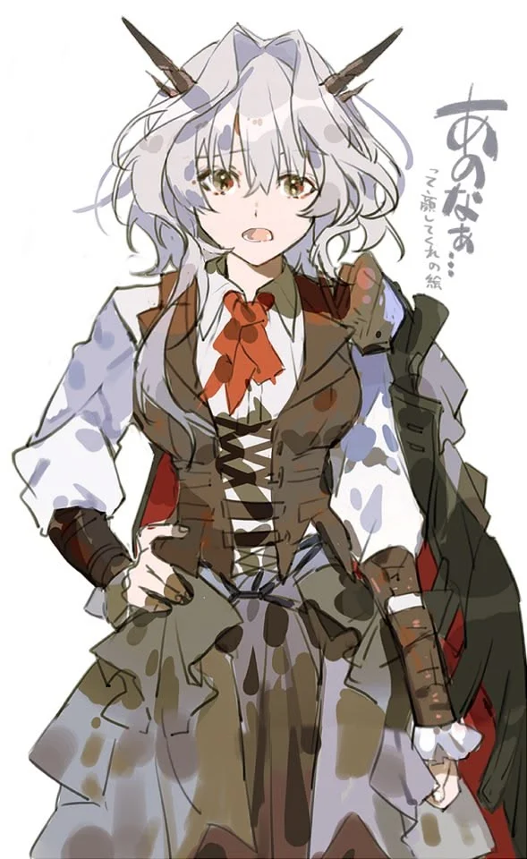

<h1 align="center">Hi, I'm Artdi</h1>

  

  &nbsp;&nbsp;&nbsp;&nbsp;
  &nbsp;&nbsp;&nbsp;&nbsp;
  &nbsp;&nbsp;&nbsp;&nbsp;
  

 

<h2 align="center">About me</h2>

<table align="center">
  <tr>
    <td width="28%" valign="middle">
      
    </td>
    <td width="72%" valign="middle">
      <h2>Hey there</h2>
      

        I'm Artdi, a fullstack developer from Indonesia. I like building things end to end,
        from the database all the way to the last pixel of the UI, and I care a lot about
        apps that feel fast, look clean and are fun to use.
      

      

        Most of my time goes into TypeScript, with Go and Python whenever a project needs
        something heavier, like realtime video or a bit of machine learning.
      

      

        Outside of code I play rhythm games, chase that last 0.1% of accuracy, and keep
        music running in the background while doing both.
      

      

        <h4>Main stack</h4>
        Next.js, React, Bun, Elysia, PostgreSQL
      

    </td>
  </tr>
</table>

 

<h2 align="center">Tech stack</h2>

<h3 align="center">Languages</h3>

  

<h3 align="center">Frontend</h3>

   
  
  
  
  

<h3 align="center">Mobile</h3>

   
  
  

<h3 align="center">Backend</h3>

   
  
  

<h3 align="center">Database and storage</h3>

   
  
  
  

<h3 align="center">AI and media</h3>

   
  
  
  

<h3 align="center">Testing</h3>

   
  
  

<h3 align="center">Tools and platform</h3>

  

 

<h2 align="center">GitHub stats</h2>

  
  

  

  <picture>
    <source media="(prefers-color-scheme: dark)" srcset="https://raw.githubusercontent.com/Artdi222/Artdi222/output/github-snake-dark.svg" />
    <source media="(prefers-color-scheme: light)" srcset="https://raw.githubusercontent.com/Artdi222/Artdi222/output/github-snake.svg" />
    
  </picture>

 

  

